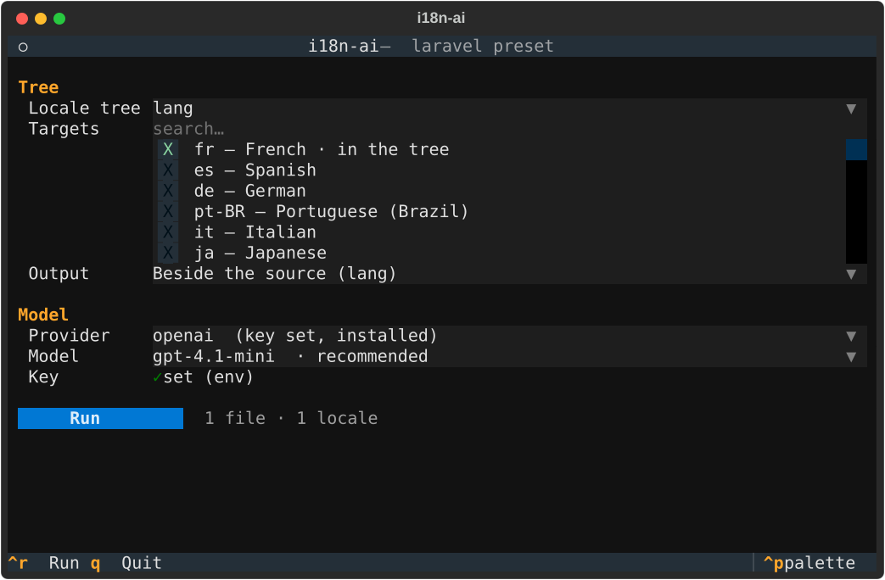
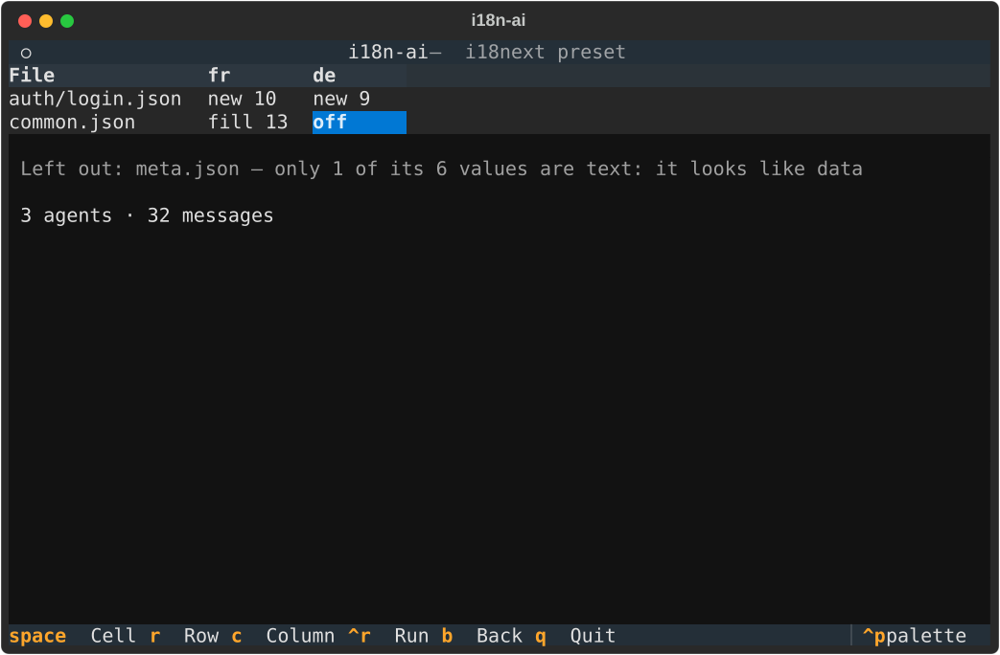

# Getting started

## Install

```sh
uv tool install i18n-ai          # or: pipx install i18n-ai
i18n-ai --version
```

i18n-ai needs Python 3.12 or later. A provider's LangChain package (`langchain-openai`,
`langchain-anthropic`, …) is not installed with it: i18n-ai installs the one your model needs the
first time you use it, into its own environment, after asking. See [Providers](providers.md).

## Just run it

In your project, run `i18n-ai` alone. At a terminal it opens a full-screen form:



It finds the locale trees in the project, the one your i18n library keeps first (see
[Your framework](frameworks.md)), offers every CLDR locale (the ones already in the tree
checked; type to search), lists the providers with the ones ready to use first, and reads the
chosen provider's model list from its API, the recommended models first. A field waits until
what it depends on is set: the model for its provider, the targets for their tree. A missing API
key is asked for, hidden, and used for that run; it is saved in the system keyring only if you
tick the box. The line beside **Plan** says how many files and locales the run covers.

`Ctrl+R` plans it, after asking to install the provider's package if it is missing. The plan
shows each file in each locale, before anything is sent to a model:



A cell is **new** (no target file yet) or **fill** (a target exists) with the messages it will
translate, **up to date** when there is nothing to translate, or **off**. `Space` turns the cell
under the cursor off or on, `r` its whole row (a file), `c` its whole column (a locale). The
files left out are listed with their reason, and the line under the grid totals what is on.

`Ctrl+R` again runs it: no other question. The run screen keeps the plan's grid, and each cell
follows its file and locale live: waiting, translating, **retry 2/3** when the model's answer
broke a rule and goes back to it, then written, partial (with fallbacks: messages left in their
source text), failed or ignored. Under it, a bar, and **Problems**: each failed or partial file
as it comes. Then the receipt, and the one-line command that repeats the run without the form.
A file turned off is an `--exclude` in that command, a locale turned off is not among its
targets; single cells have no option of their own, so the receipt says when the command runs them too.
`b` goes back, `q` quits, `Ctrl+P` opens the command palette. `i18n-ai tui` opens it too.

### The prompts

`i18n-ai generate` at a terminal asks for what it was not told, one question at a time:

```text
? Which locale tree?          » public/locales  [directory: en, fr]
? Which locales to generate?  (type to search, space to pick)  ● fr — French · in the tree
? Where do the new locales go? » Beside the source (public/locales)
? Which provider?             » openai  (key set, installed)
? Which openai model?         » gpt-4.1-mini  · recommended
```

Then comes the precheck and the go-ahead, as below, and at the end the one-line command that
repeats the run without a question.

Only what a run is not told is asked: `i18n-ai generate locales/en -t fr` asks for the model
alone, and not even that when `I18N_AI_MODEL` is set. The answers are remembered per project and
offered as the defaults next time. Nothing is asked with `--no-input`, on CI (`CI=true`), or when
the input or output is not a terminal: a missing path or target is then an error, as in a script.

## Credentials

The provider reads its key from its usual environment variable: `OPENAI_API_KEY`,
`ANTHROPIC_API_KEY`, `GOOGLE_API_KEY`, `MISTRAL_API_KEY`, `GROQ_API_KEY`… A `.env` in the
working directory is read too, without overriding the environment:

```sh
# .env
OPENAI_API_KEY=sk-...
I18N_AI_MODEL=openai:gpt-4.1-mini
```

Or keep the key in the system keyring (the macOS Keychain, the Windows Credential Manager, or
the Secret Service of GNOME Keyring and KWallet on Linux), once for every project, instead of a
`.env` that is easy to commit by mistake:

```sh
i18n-ai auth login openai                          # asked for, hidden
printenv OPENAI_API_KEY | i18n-ai auth login openai  # or read from stdin
i18n-ai auth status                                # where each provider's key comes from
i18n-ai auth logout openai                         # or --all
```

A key is looked up in the environment, then the `.env`, then the keyring: the first found wins,
and `auth status` tells which. It is saved as service `i18n-ai`, user `OPENAI_API_KEY`. Where
there is no keyring (a headless box), `auth login` says so and nothing is written: keep the key
in the environment or the `.env`.

A local model through [Ollama](https://ollama.com) needs no key: `ollama pull qwen2.5:7b`, then
`-m ollama:qwen2.5:7b`.

## The precheck

Point `scan` at the source locale, and name the targets:

```sh
i18n-ai scan locales/en -t fr,ar
```

It shows the layout it found, the source locale and the other existing ones, every source file
and whether it qualifies (an object of mostly text, not configuration or data), and for each
target the files it will write and how many messages need translating. Nothing is sent to a
model.

## The generation

```sh
i18n-ai generate locales/en -t fr,ar -m openai:gpt-4.1-mini -c "An online bookshop"
```

`generate` runs the same precheck, then asks before installing the provider's package if it is
missing, and before translating. `-y` skips both questions; `--dry-run` stops after the
precheck.

Each file is written as soon as its agent finishes, the way its source is written. The table at the
end tells, for each file and locale, what was written, how many messages were translated or
kept, and any message that kept failing the rules (it keeps its source text, and is listed).

`-c, --context` tells the model what the website is, which sets its tone and vocabulary. It is
worth one sentence.

## Run it again

A second run translates only what is missing or broken: the existing translations that pass the
rules are kept. `--overwrite` translates everything again.
